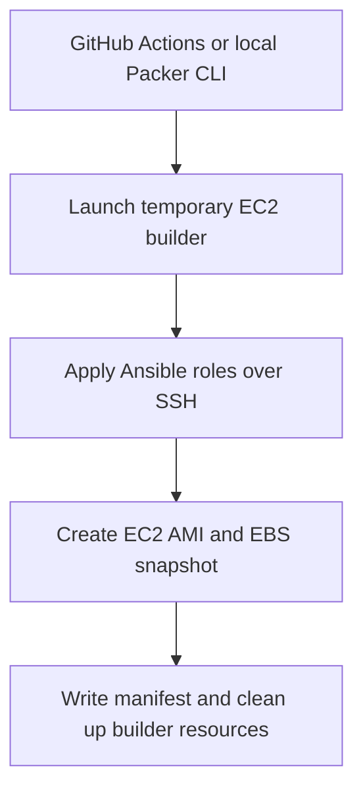

# AWS Golden AMI Pipeline

Build an Amazon Linux 2023 x86_64 base image for EC2 with HashiCorp Packer, Ansible, and GitHub Actions. The resulting `base-aml3-x64` image gives workloads a common starting point with OS package updates, standard utilities, and SSSD packages prepared for environment-specific configuration.

## Why build a golden AMI?

Installing the same packages on every instance at launch makes boot depend on package repositories and can produce different results across instances. This project moves common setup into the image build. The image ID in the Packer manifest gives operators a specific artifact to verify and pass to a downstream launch template.

## Build flow



Packer uses the `amazon-ebs` builder to select the most recent Amazon-owned, EBS-backed Amazon Linux 2023 x86_64 image matching the template filter. It builds on a temporary `t3.micro` and configures the resulting AMI to default to IMDSv2. Ansible connects to the temporary instance and applies the roles in `ansible/harden.yml`. Packer then stops the builder, creates the AMI, and records the artifact in `manifest.json`. GitHub Actions validates the configuration, builds the AMI, and uploads the manifest.

## Project layout

| Path | Purpose |
| --- | --- |
| `source.pkr.hcl` | Packer plugins, source AMI selection, and EC2 builder settings |
| `builder.pkr.hcl` | Ansible provisioner and manifest post-processor |
| `variables.pkr.hcl` | Region and build subnet input declarations |
| `dev.pkvars.hcl` | Region and subnet values for the dev build |
| `ansible/harden.yml` | Playbook that applies `basic` followed by `sssd` |
| `ansible/roles/basic/defaults/main.yml` | Default packages, including Git, jq, and unzip |
| `ansible/roles/basic/tasks/main.yml` | Updates existing packages and installs the base utilities |
| `ansible/roles/sssd/tasks/main.yml` | Installs SSSD and its tools, restricts configuration directory access, and leaves the service disabled |
| `.github/workflows/packer.yml` | Packer validation and build automation |
| `manifest.json` | Generated build metadata, including the AWS Region and candidate AMI ID |

SSSD is prepared for configuration at instance launch. The identity provider, domain join, and credentials belong in the target environment.

## Prerequisites

- An AWS account, an Amazon Linux 2023 x86_64 source AMI, and a build subnet in the same Region. Use `ap-southeast-1` to match the example build, or supply your own Region.
- Network access from the runner to the temporary EC2 instance over SSH, plus outbound access from the instance to its package repositories.
- AWS permissions for Packer to describe resources, launch and terminate the builder, manage temporary SSH resources as configured, and create and tag the AMI and its snapshots.
- For local builds, install Packer, Ansible Core, and the AWS CLI. Authenticate to AWS before running the build.

## Run a local build

Use the repository root as the working directory. Edit `dev.pkvars.hcl` to set `aws_region` and `build_subnet_id` for your AWS account. The builder assigns a public IP and creates a temporary security group restricted to the build runner’s public IP for SSH. Use a public subnet with a route to an internet gateway.

```bash
ansible-playbook -i localhost, --syntax-check ansible/harden.yml
packer init .
packer fmt -check -recursive .
packer validate -var-file=dev.pkvars.hcl .
packer build -var-file=dev.pkvars.hcl .
```

The Ansible provisioner should reference `ansible/harden.yml` and run the playbook without the old `--tags level1-server,sssd` filter. Watch for tasks from both roles in the output.

## Run from GitHub Actions

The **Packer AMI Build** workflow runs on pushes to `main` or branches matching `release*`, on pull requests targeting those branches, and on manual dispatch. Both jobs use the `dev` GitHub environment.

| Job | What it does |
| --- | --- |
| **Validate Packer** | Installs Packer and Ansible, checks playbook syntax, initializes plugins, checks HCL formatting, and validates the template with `dev.pkvars.hcl`. |
| **Build Packer** | Runs after validation, assumes an AWS role through GitHub OIDC, builds the image, and uploads `manifest.json` as `packer-ami-manifest`. |

Set `AWS_ROLE_ARN` and `AWS_REGION` in the `dev` environment or at repository level. Match `AWS_REGION` to `aws_region` in `dev.pkvars.hcl`. For the environment-based OIDC role, use audience `sts.amazonaws.com` and subject `repo:<github_account>/<github_repo_name>:environment:dev`. Set environment protection rules to match your intended build policy. The current build job has no event filter, so a pull request can reach it after validation if environment rules and credential access allow it.

To start manually, open **Actions → Packer AMI Build → Run workflow**, select the branch, and download **packer-ami-manifest** after the build completes.

## Verify the candidate image

1. Read the AMI ID and Region from the build output or the manifest's `artifact_id`.
2. Check the Ansible log for both `basic` and `sssd` tasks.
3. Launch a temporary EC2 instance from the candidate AMI. Connect to it and run:

   ```bash
   uname -m
   rpm -q git jq unzip sssd sssd-tools
   sudo stat -c '%U:%G:%a' /etc/sssd
   systemctl is-enabled sssd.service
   systemctl is-active sssd.service
   ```

   Expect `x86_64`, all listed packages installed, `root:root:700`, and SSSD reporting `disabled` and `inactive`. The last two commands can return nonzero for those expected states.
4. Terminate the verification instance once the checks are complete.

A run can produce an AMI even if Ansible only reports **Gathering Facts**. If that happens, remove the stale tag filter from the Packer Ansible provisioner and rebuild before using the image. A successful image registration confirms the build produced an artifact. The fresh-instance check confirms what was baked into it.


